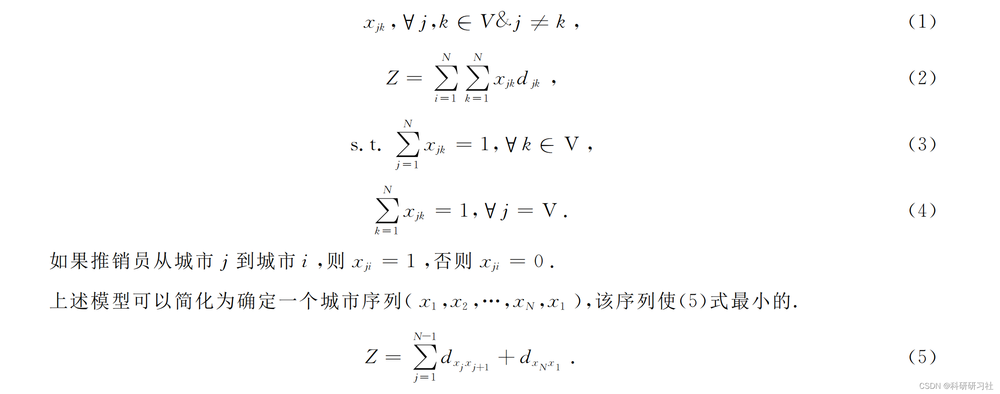
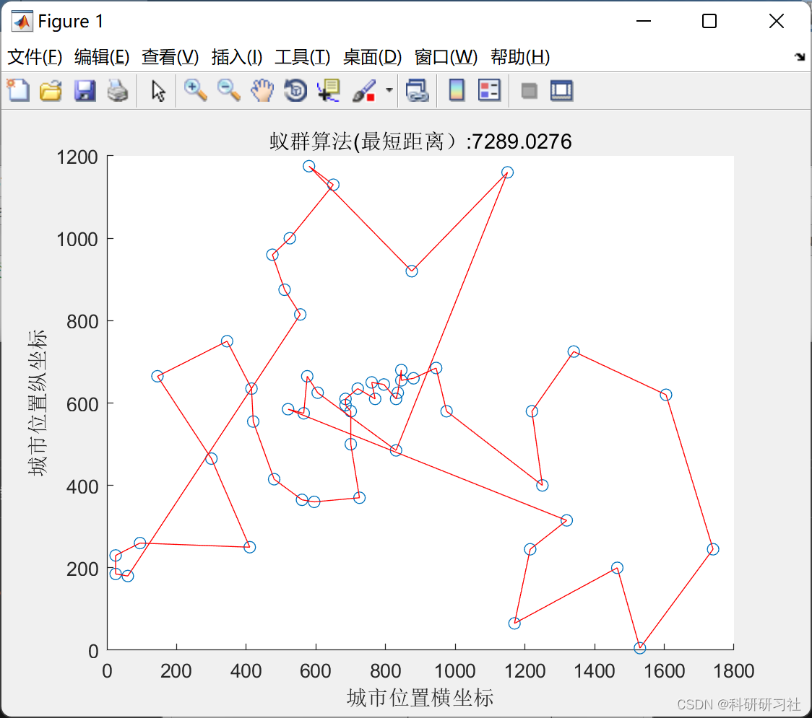
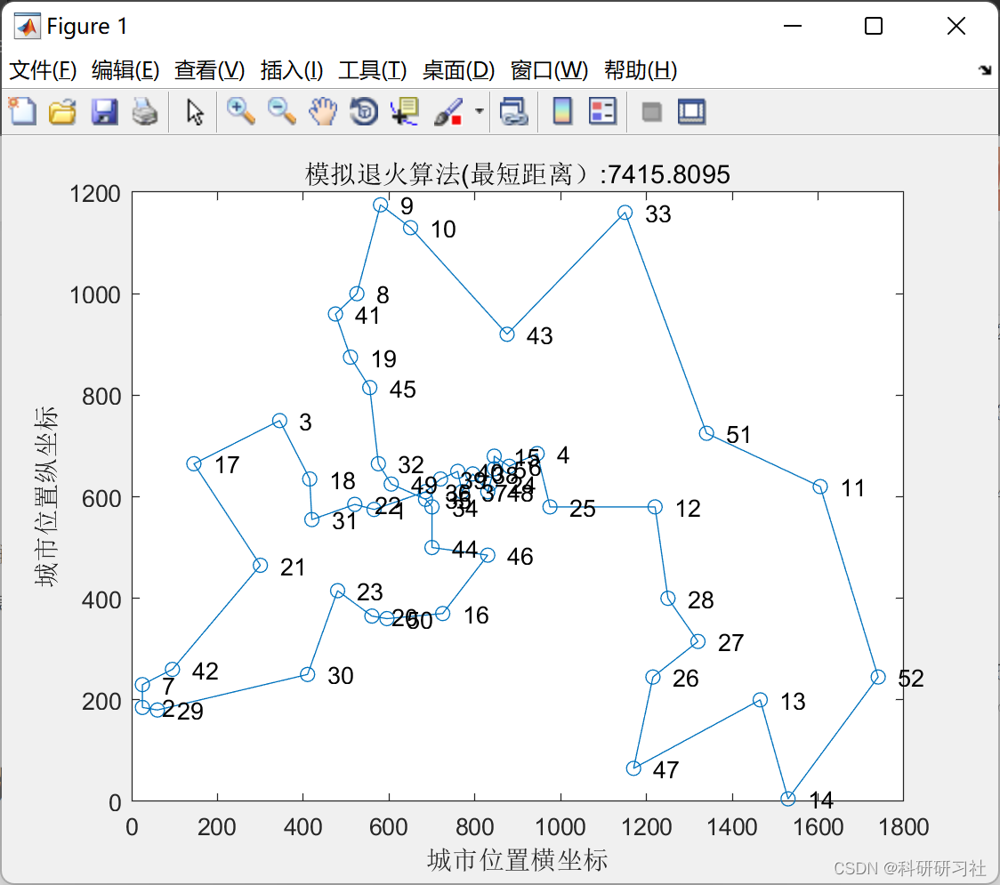

# Simulated Annealing and Ant Colony Optimization Algorithm for TSP Problem (Matlab Code Implementation)

​  
1. Overview of the Traveling Salesman Problem (TSP) is defined as a salesman traveling through all cities to return to his original city with the lowest cost. The computational scale of the TSP problem increases exponentially with the number of city nodes. Finding an ideal solution with reasonable costs is very important. This problem consists of a set of N city nodes. The distance between any two city nodes is known. The salesman starts from one node, Each node must return to the starting node in the shortest possible path, except for the starting node itself. The TSP problem can be solved using a graph G=(V, E), where V is the set of nodes and E is the set of edges. E) Expresses, Among them, V = {1, 2, ..., N is a set of urban nodes. E is a set of edges.
Each side has a value representing the distance, which represents the distance from the city associated with it. The salesperson travels to N cities.
When in a city (or node), he only visits each city once and ends with the shortest travel distance. Let's denote this as the distance between city j and city i.
The distance can be transformed into the following model:
Editor
2. Ant Optimization Algorithm Execution Results - Edit
3. Simulated Annealing Solutions
4. Matlab Code Download - This article only displays a portion of the code, please click the link to download the entire code:
Simulated Annealing and Ant Colony Optimization Algorithm for TSP Problem (Matlab Code Implementation)
n=size(C,1); %n represents the scale of the problem (number of cities)\nD=zeros(n,n);%D represents the weighted adjacency matrix of a complete graph\nfor i=1:n\n    for j=1:n\n        if i~=j\n            D(i,j)=((C(i,1)-C(j,1))^2+(C(i,2)-C(j,2))^2)^0.5;\n        else\n            D(i,j)=eps;      %i=j is not considered, should be 0, but the heuristic factor should be taken as the reciprocal, represented by eps (floating point relative precision).\n        end\n        D(j,i)=D(i,j);   %Symmetric Matrix\n    end\nend\nEta=1./D;                     %Eta is the heuristic, set to the reciprocal of distance here.\nTau=ones(n,n);                %Tau is the pheromone matrix.\nTabu=zeros(m,n);              % Storage and recording of path generation\nNC=1;                         % Iteration counter, records the number of iterations\nR_best=zeros(NC_max,n);       % Best Routes for Each Generation\nL_best=inf.*ones(NC_max,1);   % The length of the best route for each generation\nL_ave=zeros(NC_max,1);        % Average length of various generations of routes\n  
​  

## Images

<!-- PAYMENT_BLOCK -->

## Get this dataset

- Payment link (Stripe): [Buy now](https://buy.stripe.com/3cs8yP7sY87d0vu9AB)
- Payment QR code: 

<!-- /PAYMENT_BLOCK -->
